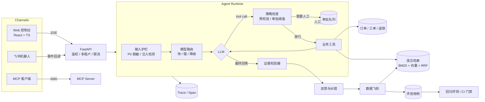

# LoopDesk · 证据优先的企业客服 Agent 平台

[](https://github.com/leon1111-wgl/loopdesk/actions/workflows/ci.yml)

**每一句回答都有出处，每一个高风险动作都要人复核，每一次人工纠错都会变成回归测试。**

LoopDesk 是一个面向企业客服场景的 Agent 平台：知识库问答（RAG）、订单 / 物流 / 退款 / 工单工具调用、人工审批、逐句证据校验、数据飞轮和回归评测，都放在同一个可观测的系统里。

作者：**Leon Wang** · 个人项目 · 仓库中的企业、订单与客户数据全部为虚构（SYNTHETIC）。


> 上图：管理员打开「演示模式」后，离线模型在回答末尾编造了一句“90 天无理由退货，2 小时到账”。校验器发现证据里没有 90 和 2 这两个数字，把这句话标红，并把整条回答判为“证据冲突”。

---

## 它解决什么问题

企业愿意把客服交给大模型，但上线后通常会卡在三件事上：

| 痛点 | 后果 | LoopDesk 的做法 |
|---|---|---|
| 幻觉：退款时效、费用、额度答错 | 直接引发客诉 | **证据绑定**：回答按句拆开，引用必须存在，数字必须与证据一致；严格模式下不达标的回答不会发出 |
| 越权与资损：Agent 自己把钱退出去 | 资金风险，无法追责 | **可复核动作**：工具按风险分级，超出租户额度的退款进入审批队列，并附上 Agent 的证据包；审批人不能是申请人本人 |
| 修了又犯：bad case 靠人记 | 质量不可控，改 Prompt 怕出问题 | **数据飞轮 + 回归门禁**：一次纠错同时生成知识补丁和评测用例；评测集进 CI，通过率低于阈值就阻止合并 |

## 功能一览

<table>
<tr>
<td width="50%"><br><b>审批队列</b>：金额、原因和 Agent 提交的证据包，通过后重新校验订单再执行</td>
<td width="50%"><br><b>链路追踪</b>：护栏、路由、模型、工具、审批、校验，每一步的输入输出和耗时</td>
</tr>
<tr>
<td><br><b>评测中心</b>：按轨迹打分（工具、审批、检索命中、证据校验），并和上一次运行做对比</td>
<td><br><b>检索调试器</b>：BM25 名次、向量名次、RRF 分数、相关度阈值、注入样本屏蔽</td>
</tr>
<tr>
<td><br><b>运营看板</b>：自助解决率、转人工率、证据覆盖率、缓存命中率、Prompt 版本对比，支持导出 CSV</td>
<td><br><b>深色模式</b>：跟随系统，也可以手动切换</td>
</tr>
<tr>
<td colspan="2"> <br><b>手机端</b>：窄屏下用抽屉式导航，审批卡片改为单列，主管在手机上也能处理审批</td>
</tr>
</table>

**Agent 与 RAG**
- 自研 Agent 循环（不依赖框架）：流式输出、多步工具调用、最大步数保护、模型降级重试。
- 混合检索：jieba 分词 + BM25 与向量检索，用 RRF 融合；IDF 加权的“词覆盖率”作为绝对相关度，最关键的词缺失时 Agent 会拒答，而不是答非所问。
- 按标题切分文档并保留章节路径；入库时扫描提示注入，命中的片段不会进入模型上下文。
- 知识冲突检测：文档入库或补丁发布时，比对其他文档中同一主题、带单位的数字（天、元、积分……），发现“1-2 个工作日”和“1-3 个工作日”这类矛盾就记录下来并提醒管理员，而不是等顾客拿到错误答案。
- 多轮追问改写：识别“那运费谁出？”这类追问，结合上一问改写成完整问题再交给 Agent（真实模型下用快模型改写，离线时用规则改写）。对话中保存用户的原话，链路中记录改写结果。对应的多轮评测用例在修复前失败，修复后通过。
- 权限感知检索：内部文档只对员工可见。
- 知识版本感知的答案缓存：重复的 FAQ 直接复用已经通过证据校验的回答，命中时消耗 0 token。缓存键包含知识库版本签名、提示词和模型配置指纹以及可见范围，所以知识一更新缓存就自动失效，内部答案也不会经缓存泄漏给顾客。

**安全与治理**
- 多租户隔离：跨租户访问一律返回 404，避免通过 ID 探测数据。
- RBAC：管理员 / 客服坐席 / 顾客三种角色。
- 工具层鉴权：身份取自登录态，而不是模型生成的参数，所以 Prompt 注入也查不到别人的订单。
- 审批通过后，执行前再校验一次订单状态（防 TOCTOU）；同一订单不能重复提交待审批的退款申请。
- 累计退款风控（防“薅羊毛”）：同一顾客 30 天内已退款 3 笔或累计超过 200 元时，即使单笔低于自动审批额度也要人工审核。统计按顾客而不是按操作人，坐席代为申请也绕不过去。
- 手机号、身份证、银行卡、邮箱在进入模型和写入日志前脱敏；接口带限流。

**质量闭环**
- 数据飞轮：纠错 → 失败归因（知识缺失 / 检索未命中 / 无依据 / 工具错误）→ 候选评测用例 + 知识补丁草稿 → 管理员发布 → 重建索引并激活用例。
- 回归评测在**隔离沙箱库**中运行：知识库和租户配置取自当前环境，订单数据取自固定夹具，所以演示中的真实退款不会把用例变红。
- Prompt 版本化：提示词按版本登记，评测 CLI 支持 `--compare v1,v2` 做离线 A/B（任何用例回归即失败）；线上按会话哈希稳定分流做灰度，看板按版本对比转人工率、证据覆盖率和 token。离线 A/B 中精简版 v2 的 token 减少 31%，并且没有回归；它对回答质量的影响需要用真实模型验证。

**集成**
- 模型：豆包（火山方舟）、混元、DeepSeek、通义、OpenAI 统一走 OpenAI 兼容协议；Claude 使用官方 SDK；没有 Key 时使用离线确定性模型。
- 渠道：飞书机器人事件回调（challenge 校验、事件去重、3 秒内先回 200，后台处理失败时记录日志并回复兜底话术）、企业微信群机器人审批提醒。
- MCP：只读工具通过 MCP 暴露，Claude Desktop、Cursor 等客户端可以直接接入。
- 运维：Prometheus `/metrics`、Docker、docker-compose（PostgreSQL）、GitHub Actions（SQLite + PostgreSQL 双库测试、评测门禁、镜像构建）。
- 数据库迁移：Alembic 管理表结构版本，启动时自动升级；对旧版本用 `create_all` 建的库会补齐缺失的表并标记为最新版本。CI 在 SQLite 和 PostgreSQL 上都会校验“模型定义与迁移脚本完全一致”。
- 可排障：每个请求都带 `X-Request-ID`（可以沿用网关传入的 ID），它会写进 JSON 结构化日志和 Agent 运行记录；发生 500 错误时只返回 request_id，不暴露内部信息；`/api/ready` 检查数据库和迁移版本，供 Kubernetes 和 Docker 的健康检查使用，`/api/health` 用作存活检查。
- 数据导出：对话记录、反馈、审批可按天数导出为 CSV（带 UTF-8 BOM，Excel 打开不乱码；对以 `=` `+` `-` `@` 开头的单元格做转义，防止 CSV 公式注入；按租户隔离，导出的文本是已脱敏的版本）。

## 架构



设计细节见 [docs/ARCHITECTURE.md](docs/ARCHITECTURE.md)。

## 快速开始

**环境要求**：Python 3.11+、Node 20+（推荐 pnpm）。不需要任何 API Key。

```bash
# 后端
cd backend
python -m venv .venv && source .venv/bin/activate
pip install -r requirements.txt
uvicorn app.main:app --reload --port 8000
```

```bash
# 前端（另开一个终端）
cd frontend
pnpm install
pnpm dev            # http://localhost:5173 ，/api 会代理到 8000
```

首次启动会自动创建两个演示租户、知识库、订单和几段演示对话。登录页列出了所有演示账号，点击即可进入。

**Docker**（PostgreSQL + 单镜像）：

```bash
docker compose up --build    # http://localhost:8000
```

**测试与评测**：

```bash
cd backend
pytest -q                                          # 全部测试
python -m app.evals.cli --fresh --gate 0.95        # 回归评测，低于 95% 退出码为 1
```

## 接入真实模型

在 `.env` 中设置（完整说明见 [docs/DEPLOYMENT.md](docs/DEPLOYMENT.md)）：

```bash
LOOPDESK_LLM_PROVIDER=openai_compat
LOOPDESK_LLM_PRESET=doubao              # doubao | hunyuan | deepseek | qwen | openai
LOOPDESK_LLM_API_KEY=...
LOOPDESK_LLM_MODEL_STRONG=<控制台里的模型或接入点 ID>
LOOPDESK_LLM_MODEL_FAST=<更便宜的模型>
LOOPDESK_VERIFIER=llm                   # 真实模型会改写措辞，用 LLM 判定句子是否有依据（数字校验始终开启）
```

## 评测结果

| 评测集 | 用例数 | 通过率 | 证据覆盖率 | p50 / p95 | 说明 |
|---|---|---|---|---|---|
| Leon优选 default | 23 | 100% | 100% | 3ms / 7ms | 覆盖 RAG、多轮追问、拒答、RBAC、订单工具、审批、累计风控、注入攻击 |
| Iris云 default | 3 | 100% | 100% | — | 含跨租户隔离用例 |

> **请如实理解这些数字**：它们来自**离线确定性模型和虚构数据**，只能证明“流程按设计工作”（工具调对了、审批触发了、注入被挡住了），**不代表真实模型的回答质量**。换成真实模型后请重新运行评测，方法见 [docs/EVALUATION.md](docs/EVALUATION.md)。

**答案缓存基准**（`python -m app.evals.cache_bench`）：10 个 FAQ 问题各问两遍，第二遍 100% 命中缓存，答案与第一遍一致，token 从 8,946 降到 0。p50 延迟从 385ms 降到 1ms，但离线模型带有 20ms 的模拟流式延迟，这个延迟数字只能说明检索和模型调用被跳过了。

## 目录结构

```
backend/
  app/
    agent/        Agent 循环、工具注册与业务工具、证据校验器、链路追踪
    rag/          解析与切分、Embedding、BM25 + 向量 + RRF 混合检索、入库
    llm/          OpenAI 兼容 / Claude / 离线模型适配器、模型路由
    guardrails/   PII 脱敏、提示注入检测
    flywheel/     反馈归因、知识补丁、评测用例生成
    evals/        沙箱评测运行器、CLI 门禁
    channels/     飞书、企业微信
    api/          REST + SSE 接口
    mcp_server.py MCP 服务
  evals/          评测集（JSONL）
  seed_data/      演示知识库（Markdown）
  tests/          pytest
frontend/src/     React 控制台（对话、审批、知识库、链路、飞轮、评测、看板）
docs/             架构、评测、部署文档
```

## 技术栈

Python 3.12 · FastAPI · SQLAlchemy 2 · SQLite / PostgreSQL · jieba · httpx · PyJWT · pytest · React 19 · TypeScript · Vite · Docker · GitHub Actions · MCP

## 路线图

- [ ] 向量库切换到 pgvector / Milvus，支持十万级片段
- [ ] 异步化 Agent 循环（async httpx + async SQLAlchemy），并支持多副本部署（限流和事件去重改用 Redis）
- [ ] 评测集扩展到 200 条以上，接入真实模型做 A/B 对比
- [ ] 多 Agent：把售后和技术支持拆成两个专职 Agent，由路由 Agent 分派
- [ ] 飞书加密事件（AES）与企业微信应用消息回调

## 声明

本项目为个人学习与求职作品。仓库中的企业名称、订单、客户和对话全部为虚构数据，不代表任何真实企业的政策。
