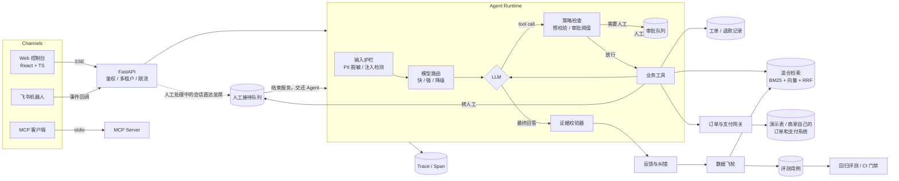

# LoopDesk · 证据优先的企业客服 Agent 平台

[](https://github.com/leon1111-wgl/loopdesk/actions/workflows/ci.yml)

**[打开在线演示 ↗](https://leon1111-wgl.github.io/loopdesk/)**（不用安装，选一个角色进入：顾客、坐席或管理员）· [案例：一位顾客的退款，从提问到钱退回去](docs/CASE_STUDY.md) · [架构](docs/ARCHITECTURE.md) · [评测](docs/EVALUATION.md) · [语音通道](#语音通道voice-agent)

**每一句回答都有出处，每一个高风险动作都要人复核，每一次人工纠错都会变成回归测试。**

LoopDesk 是一个面向企业客服场景的 Agent 平台：知识库问答（RAG）、订单 / 物流 / 退款 / 工单工具调用、人工审批、逐句证据校验、数据飞轮和回归评测，都放在同一个可观测的系统里。

**演示场景**：主场景是虚构的音乐流媒体平台 **Echo音乐**，参照同类音乐 App 的会员客服设计：会员连续包月与自动续费退款、取消续费（含 App Store 渠道）、数字专辑、Echo币与未成年人误充值、歌曲变灰与版权、无损音质与离线下载。另外两个租户说明同一套平台换行业也能用：电商 **Leon优选**（实物订单、物流、七天无理由退货）和 SaaS **Iris云文档**（帮助中心与 SLA）。

作者：**Leon Wang** · 个人项目 · 仓库中的企业、订单与客户数据全部为虚构（SYNTHETIC），与任何真实企业无关。


> 上图：管理员打开「演示模式」后，离线模型在回答末尾编造了一句“90 天无理由退货，2 小时到账”。校验器发现证据里没有 90 和 2 这两个数字，把这句话标红，并把整条回答判为“证据冲突”。

---

## 它解决什么问题

企业愿意把客服交给大模型，但上线后通常会卡在三件事上：

| 痛点 | 后果 | LoopDesk 的做法 |
|---|---|---|
| 幻觉：退款时效、费用、额度答错 | 直接引发客诉 | **证据绑定**：回答按句拆开，引用必须存在，数字必须与证据一致；严格模式下不达标的回答不会发出 |
| 越权与资损：Agent 自己把钱退出去 | 资金风险，无法追责 | **可复核动作**：工具按风险分级，超出租户额度的退款进入审批队列，并附上 Agent 的证据包；审批人不能是申请人本人，大额退款只有管理员能通过，驳回必须写明原因 |
| 修了又犯：bad case 靠人记 | 质量不可控，改 Prompt 怕出问题 | **数据飞轮 + 回归门禁**：一次纠错同时生成知识补丁和评测用例；评测集进 CI，通过率低于阈值就阻止合并 |

最近的迭代见 [CHANGELOG.md](CHANGELOG.md)：四轮“找茬—修复—复核”（37 个问题，已修复 28 个）和两次独立代码审查、模型故障兜底（规则直达人工、引用原文的降级回答、熔断）、审批分级与员工操作审计、工单工作台、多进程部署下的正确性（共享登录限流、飞书事件去重与收件箱）、知识冲突未核对时转人工、检索随知识库规模扩展（2 万片段 391ms → 10ms）、管理操作审计与防篡改、OpenTelemetry 导出。

## 功能一览

（截图目前取自电商租户 Leon优选。）

<table>
<tr>
<td width="50%"><br><b>审批队列</b>：金额、原因和 Agent 提交的证据包，通过后重新校验订单再执行</td>
<td width="50%"><br><b>链路追踪</b>：护栏、路由、模型、工具、审批、校验，每一步的输入输出和耗时</td>
</tr>
<tr>
<td><br><b>评测中心</b>：按轨迹打分（工具、审批、检索命中、证据校验），并和上一次运行做对比</td>
<td><br><b>检索调试器</b>：BM25 名次、向量名次、RRF 分数、相关度阈值、注入样本屏蔽</td>
</tr>
<tr>
<td><br><b>人工接待</b>：转人工后 Agent 不再回答，坐席按等待时间接待、回复，处理完把对话交还智能客服</td>
<td><br><b>顾客端</b>：人工回复单独标注，底部提示当前由谁服务或排在第几位</td>
</tr>
<tr>
<td><br><b>知识冲突</b>：两份文档对同一规则写了不同的数字（时长跨单位换算后比较）；核对之前，同时用到两种说法的顾客问题转人工，不让 Agent 把两个版本都说出来</td>
<td><br><b>操作审计</b>：谁在什么时候改了风控额度、知识文档、补丁和评测用例，谁批了哪笔退款、导出了什么；配置记改前改后，文档记修改的行</td>
</tr>
<tr>
<td><br><b>运营看板</b>：自助解决率、转人工率、拒答率（都按会话计算：拒答、差评和出错不算解决）、出错率与最近 15 分钟的故障提示、证据覆盖率、缓存命中率、Prompt 版本对比，按租户时区的自然日统计，支持导出 CSV（会话全文、工单、人工接待、运行记录、反馈、审批，按租户时区）</td>
<td><br><b>深色模式</b>：跟随系统，也可以手动切换</td>
</tr>
<tr>
<td colspan="2"> <br><b>手机端</b>：窄屏下用抽屉式导航，审批卡片改为单列，主管在手机上也能处理审批</td>
</tr>
</table>

**Agent 与 RAG**
- 自研 Agent 循环（不依赖框架）：流式输出、多步工具调用、最大步数保护、模型降级重试。
- 模型故障兜底：“转人工”“我要投诉”这类明确要求由规则识别，不经过模型直接转人工；两档模型都失败或熔断打开时，知识问题直接引用政策原文并注明出处，涉及订单或无可引用内容的转人工；每个模型一个熔断器，失败的模型暂停调用，顾客不再挨个等超时。
- 运行不会悬空：流式运行与连接解耦，顾客关掉页面也会跑完；运行时自身出错时把运行记为失败；进程被杀掉（kill -9、OOM、容器回收）留下的“运行中”记录，由 `python -m app.ops.stale_runs`（每分钟一次，实例启动时也执行一次）在超过时限（运行时限加上它管不到的追问改写和 LLM 校验，再留 60 秒，默认 290 秒）后记为失败并导出链路，顾客还在等这次回答时在对话里留一条系统提示；审批恢复途中被杀掉的，退款没执行就把审批单退回待审批（记审计，再次通过只付一次），执行了就把退款结果告诉顾客，驳回则保留并告知审核意见。按时间判断，多实例部署时不会误伤别的实例正在执行的运行。
- 混合检索：jieba 分词 + BM25 与向量检索，用 RRF 融合；IDF 加权的“词覆盖率”作为绝对相关度，最关键的词缺失时 Agent 会拒答，而不是答非所问。
- 查询归一化：先把异体字和常见错别字统一（“到帐”改为“到账”），再用小型领域同义词表把口语短语扩展成知识库里的标准说法（“专票”扩展为“增值税专用发票”，“多掏钱”扩展为“额外支付 运费”），只追加、不替换。新增的 5 条口语评测用例在修复前全部检索失败，修复后全部通过。相关度门槛（词覆盖率）则改用**替换后**的标准说法计算：“能寄到国外吗”里的“寄到”“国外”不在知识库词表里，IDF 最高，留在分母里只会把分数拖到阈值以下，所以门槛按“配送 海外”打分；召回仍用追加后的完整查询。另一批 5 条口语用例（“能开发票吗”“退货运费谁出”等）由此从拒答或答错变为正确。
- 按标题切分文档并保留章节路径；入库时扫描提示注入和诈骗话术（先做全角、空格、零宽字符归一化；索要验证码或银行卡号、私人微信、转账押金），命中的片段不进入检索，带原因等管理员复核放行。
- 输出检查：回答发给顾客之前再查一次是否索要验证码、银行卡号、密码，或要求先付钱才能退款；回答里出现租户**官方渠道**（域名、客服账号）以外的链接或账号一律不发。流式输出按句放行；命中就不发、转人工，看板列出知识库里的来源文档。盲测集（看不到规则的模型写的 69 条攻击、82 条正常文本）上入库扫描拦住 45/69、误扣 7/82，要钱类只有 2/12，见 EVALUATION。
- 知识冲突检测：文档入库或补丁发布时，比对其他文档中同一主题、带单位的数字（天、元、积分……），发现“1-2 个工作日”和“1-3 个工作日”这类矛盾就记录下来并提醒管理员，而不是等顾客拿到错误答案；核对之前，同时用到两种说法的顾客问题转人工，不让 Agent 把两个版本都说出来。管理员可以在线修改文档，保存时用版本号做乐观锁，两人同时编辑不会互相覆盖。
- 多轮追问改写：识别“那运费谁出？”这类追问，结合上一问改写成完整问题再交给 Agent（真实模型下用快模型改写，离线时用规则改写）。对话中保存用户的原话，链路中记录改写结果。对应的多轮评测用例在修复前失败，修复后通过。连续追问时，参照的是上一轮**改写后**的问题，而不是原话；离线规则把对话拆成“话题”和“问题”两部分记下来：“那运费谁出？”保留话题、换问题，“那质量问题呢？”换话题、保留问题，“还有能开发票吗”是新问题，只去掉开头的“还有”。
- 权限感知检索：内部文档只对员工可见。
- 知识版本感知的答案缓存：重复的 FAQ 直接复用已经通过证据校验的回答，命中时消耗 0 token。缓存键包含知识库版本签名、提示词和模型配置指纹以及可见范围，所以知识一更新缓存就自动失效，内部答案也不会经缓存泄漏给顾客。

**人机协同**
- 转人工是一个状态，而不是一句话术：同一会话只开一张转人工工单（重复要求不会重复排队），排队位次只计算排在前面、尚无人接待的顾客。会话转人工后 Agent 不再回答，顾客继续发的消息原样留给人工，并告知当前位次或接待人，既不调用模型，也不虚增转人工率。
- 工单工作台：Agent 建的工单按对顾客承诺的时限排序，显示剩余时间或已超时，坐席接手、写明处理结果后关闭，结果自动发回顾客的对话；承诺时限在建单时记下，改租户 SLA 不会改写已经告诉顾客的时间；看板提示超时工单。
- 人工接待页：坐席按等待时间先后接待，第一个回复的人负责跟进，可以随时结束人工服务，把对话交还给智能客服；交还后人工的回复会作为上下文带给 Agent。飞书渠道的人工回复会直接发回飞书会话。

**语音通道（Voice Agent）**（[设计](docs/ARCHITECTURE.md#57-语音通道voice-agent) · [评测](docs/EVALUATION.md#语音评测voice-agent) · [难点](docs/CHALLENGES.md#12-语音通道voice-agent)）
- 级联：VAD 判断说完（按音频时长计时，按住说话松开即结束）→ 流式 ASR（Paraformer 流式出中间结果，一句结束后 SeACo-Paraformer 带租户热词整句重解码）→ ITN（“S O 二零二六……”→ `SO2026…`，“一百九十八块”→ 198）和热词拼音纠错 → PII 脱敏 → **同一个 Agent 运行时**（检索、工具、审批、证据校验、审计都不变）→ 输出检查放行一句就送去流式 TTS，检查不占首包时间。
- 资金动作口头确认：语音通道给运行时换一份工具注册表，退款这类 `risk=high` 的工具先把规范化后的订单号和金额念给顾客，金额那句播完、顾客说“确认”才执行，一次确认只放行这一组参数一次，之后照常走审批；确认记进审计。订单号或金额没把握（两遍识别不一致、格式不对）先复述再办。
- 顾客听到什么，对话就记什么：打断时立即停播，助手消息只保留已经播出的部分，模型下一轮不会以为没播的话已经说过；断线算“不确定是否听到”，不算打断。手机号、卡号、身份证、验证码不念出来。
- 语音模型是可选依赖，测试和 CI 不装；没有引擎时对话页不显示语音按钮。评测在 GitHub Actions 上跑：107 条门禁用例 × 8 种合成音色和语速 + babble 噪声，Paraformer / SenseVoice / Whisper 对比，热词和 ITN 前后对比，语音与文字的任务通过率和失败归因，端点检测和 TTS 时延（见下）。

**安全与治理**
- 多租户隔离：跨租户访问一律返回 404，避免通过 ID 探测数据。
- RBAC：管理员 / 客服坐席 / 顾客三种角色。权限矩阵测试会遍历 OpenAPI 中的每个接口：除了明确列出的公开接口（健康检查、登录、带校验 token 的飞书回调等），都必须要求登录；顾客只能调用列出的对话类接口。新增接口忘了加权限，测试会直接失败。
- 工具层鉴权：身份取自登录态，而不是模型生成的参数，所以 Prompt 注入也查不到别人的订单。
- 审批通过后，执行前再校验一次订单状态（防 TOCTOU）；同一订单不能重复提交待审批的退款申请。
- 售后时效由工具层判断，不靠模型自觉：签收 7 天内按规则自动处理；7 到 15 天只有质量问题可以退，工具看不到顾客上传的照片，所以一律转人工核实；超过 15 天直接拒绝，不进审批。期限按顾客提出申请的时间计算，审批排队不会让顾客因此超期。两个期限是租户配置（`PATCH /api/tenant`）。
- 累计退款风控（防“薅羊毛”）：同一顾客 30 天内已退款 3 笔或累计超过 200 元时，即使单笔低于自动审批额度也要人工审核。统计按顾客而不是按操作人，坐席代为申请也绕不过去；几笔同时提交也绕不过去（执行时按顾客加锁，在锁内重新统计）。
- 手机号、身份证、银行卡、邮箱在进入模型、写入数据库和链路之前脱敏，覆盖人们实际的输入习惯（`138-1234-5678`、`+86 138 1234 5678`、每 4 位一组的卡号）；接口带限流。
- 浏览器加固：所有响应都带 `nosniff`、`X-Frame-Options: DENY`、`Referrer-Policy`，以及只允许同源资源的 CSP（打包后的控制台已在该 CSP 下逐页验证，没有报错）。
- 时区：时间一律按 UTC 存储和比较；给人看的日期（看板的每一天、告诉顾客的付款和签收日期）按租户时区（`PATCH /api/tenant` 的 `timezone`，IANA 名称，默认 Asia/Shanghai）。早上 6 点半签收的订单，不会被说成前一天签收。
- 数据保留：`python -m app.ops.retention --days 90` 删除超过保留期的链路明细，并抹除对话正文、运行记录和已关闭工单中的文本；指标、审批和退款等审计记录保留；还在等待审批的运行、还没处理完的工单不会被处理。
- 操作审计：管理员改风控额度、售后期限、知识文档、补丁、冲突、评测用例、执行删除权，以及员工通过或驳回审批、导出数据、人工接待回复和结束服务、接手和处理工单，都会记下操作人、时间、请求 ID 和做了什么（配置记改前改后，文档记修改的行，审批记金额和意见，导出记天数和行数），在「操作审计」页面按类别查看；删除权的记录只保留账号 ID，人工回复只记消息编号（内容留在对话里，受保留期约束）。审批的记录和审批决定在同一个事务里提交，执行失败退回待审批时再记一条。每条记录带租户内连续编号和 HMAC 签名（密钥不在数据库里），页面上显示完整性校验结果，直接改库改写或删除记录会被发现。
- 登出与强制下线：退出登录会调用 `POST /api/auth/logout`，服务端让该用户已签发的凭证全部失效（凭证带版本号，退出时加一），从浏览器、代理日志里拿到的旧凭证不能再用；管理员可以用 `POST /api/admin/users/{id}/sign-out` 让某个用户所有设备下线（丢了电脑、凭证泄露），记入操作审计。代价是退出时所有设备一起退出。
- 删除权：管理员可以调用 `DELETE /api/admin/users/{id}/personal-data` 抹除某个用户的个人数据，包括对话、运行记录、工单里的文本（标题、描述是顾客原话，处理结果是写给顾客的）和针对其消息的反馈，并将账号匿名化、使其无法登录，已签发的登录凭证也立即失效（凭证带版本号，抹除时加一）；订单、退款、审批单作为财务和审计记录保留，但审批证据中引用的对话内容会被清除。

**质量闭环**
- 数据飞轮：纠错 → 失败归因（知识缺失 / 检索未命中 / 无依据 / 工具错误）→ 候选评测用例 + 知识补丁草稿 → 管理员发布 → 重建索引并激活用例。
- 回归评测在**隔离沙箱库**中运行：知识库和租户配置取自当前环境，订单数据取自固定夹具，所以演示中的真实退款不会把用例变红。
- Prompt 版本化：提示词按版本登记，评测 CLI 支持 `--compare 1.00,2.00` 做离线 A/B（任何用例回归即失败）；线上按会话哈希稳定分流做灰度，看板按版本对比转人工率、证据覆盖率和 token。离线 A/B 中精简版 v2 的 token 减少 31%，并且没有回归；它对回答质量的影响需要用真实模型验证。

**集成**
- 模型：豆包（火山方舟）、混元、DeepSeek、通义、OpenAI 统一走 OpenAI 兼容协议；Claude 使用官方 SDK；没有 Key 时使用离线确定性模型。
- 渠道：飞书机器人事件回调（challenge 校验、事件去重（记在数据库里，多 worker 和重启后都有效）、先落库再在 3 秒内回 200、后台处理失败时记录日志并回复兜底话术；处理中的进程崩溃时，补偿任务会重新认领并回答，最多重试 3 次，之后回复兜底话术）、企业微信群机器人审批提醒。
- 订单与支付系统：查订单、查物流、退款通过 `OrderGateway` / `RefundGateway` 访问外部系统，默认用演示表；按租户配置 `LOOPDESK_COMMERCE_APIS` 后接商家自己的 HTTP 接口（Bearer 令牌、可选 HMAC 签名、只重试幂等请求、回复不合约定按故障处理，每次调用记进链路）。退款先写记录再请求支付系统，随机幂等键在第一次请求前写入；支付系统没有回音时不算失败，订单继续占着，顾客被告知“正在核实”，由 `python -m app.ops.refund_reconcile` 用同一个键重发，只会退一次；确认不了的变成工单，管理员核实后记下结果（记审计）。接口约定见 [DEPLOYMENT](docs/DEPLOYMENT.md#接入你自己的订单和支付系统)。
- MCP：只读工具通过 MCP 暴露，Claude Desktop、Cursor 等客户端可以直接接入。
- 运维：Prometheus `/metrics`、Docker、docker-compose（PostgreSQL）、GitHub Actions（SQLite + PostgreSQL 双库测试、评测门禁、Playwright 端到端走查、镜像构建）。
- 数据库迁移：Alembic 管理表结构版本，启动时自动升级；对旧版本用 `create_all` 建的库会补齐缺失的表并标记为最新版本。CI 在 SQLite 和 PostgreSQL 上都会校验“模型定义与迁移脚本完全一致”。
- OpenTelemetry：配置 `LOOPDESK_OTLP_ENDPOINT` 后，每次运行导出为一条 OTel trace（`invoke_agent` → `chat <模型>` / `execute_tool <工具>`，GenAI 语义约定，含 token 用量），可直接接入 Jaeger、Grafana Tempo、Langfuse；只导出元数据，不导出对话内容。
- 可排障：每个请求都带 `X-Request-ID`（可以沿用网关传入的 ID），它会写进 JSON 结构化日志和 Agent 运行记录；发生 500 错误时只返回 request_id，不暴露内部信息；`/api/ready` 检查数据库和迁移版本，供 Kubernetes 和 Docker 的健康检查使用，`/api/health` 用作存活检查。
- 数据导出：对话记录、反馈、审批可按天数导出为 CSV（带 UTF-8 BOM，Excel 打开不乱码；对以 `=` `+` `-` `@` 开头的单元格做转义，防止 CSV 公式注入；按租户隔离，导出的文本是已脱敏的版本）。

## 架构



设计细节见 [docs/ARCHITECTURE.md](docs/ARCHITECTURE.md)。落地时会遇到的问题（以 AI Agent 特有的问题为主：幻觉、工具调用、提示注入、评测可信度、非确定性、延迟成本、模型故障、长时间运行的状态）见 [docs/CHALLENGES.md](docs/CHALLENGES.md)。

## 快速开始

**环境要求**：Python 3.11+、Node 20+（推荐 pnpm）。不需要任何 API Key。

```bash
# 后端
cd backend
python -m venv .venv && source .venv/bin/activate
pip install -r requirements.txt
uvicorn app.main:app --reload --port 8000
```

```bash
# 前端（另开一个终端）
cd frontend
pnpm install
pnpm dev            # http://localhost:5173 ，/api 会代理到 8000
```

首次启动会自动创建三个演示租户（Echo音乐、Leon优选、Iris云文档）、知识库、订单和几段演示对话。登录页列出了所有演示账号，点击即可进入。

**Docker**（PostgreSQL + 单镜像）：

```bash
docker compose up --build    # http://localhost:8000
```

**测试与评测**：

```bash
cd backend
pytest -q                                          # 全部测试
python -m app.evals.cli --fresh --gate 0.95        # 回归评测，低于 95% 退出码为 1
```

端到端走查（Playwright，真实 API + 构建后的前端 + 全新的演示库）：

```bash
cd frontend
pnpm build && pnpm exec playwright install chromium
E2E_PYTHON=../backend/.venv/bin/python pnpm e2e
```

四条路径各跨两种角色：顾客提问拿到带证据校验的回答、管理员在链路页找到这次运行；顾客申请超额退款进入审批、管理员通过后顾客页面无需刷新就收到结果；顾客转人工、坐席在人工接待页回复、顾客页面收到回复；顾客报修、Agent 建工单、坐席在工单页接手并写明处理结果、顾客在对话里看到结果。任何页面出现控制台错误、未捕获异常或 5xx 都算失败。CI 中单独一个 job 运行。

## 在线演示是怎么来的

[在线演示](https://leon1111-wgl.github.io/loopdesk/)是同一套 React 控制台的静态构建，部署在 GitHub Pages 上，没有后端。每次推送到 main，`.github/workflows/pages.yml` 先构建控制台，再在 CI 里启动真实后端（离线模型、虚构数据），按脚本让顾客提问、坐席审批和回复、管理员改额度、跑一遍回归评测，把控制台会请求的每个接口的响应和示例问题的事件流录下来（`python -m app.ops.record_demo`）。浏览器里的 `demo/replay.ts` 用这些录制回答请求：可以切换角色浏览每个页面，回放对话页的示例问题；提交类操作不会生效。演示里的数据都不是手写的，测试会检查对话页的每个示例问题都有录制、录制里没有登录凭证。

## 接入真实模型

在 `.env` 中设置（完整说明见 [docs/DEPLOYMENT.md](docs/DEPLOYMENT.md)）：

```bash
LOOPDESK_LLM_PROVIDER=openai_compat
LOOPDESK_LLM_PRESET=doubao              # doubao | hunyuan | deepseek | qwen | openai
LOOPDESK_LLM_API_KEY=...
LOOPDESK_LLM_MODEL_STRONG=<控制台里的模型或接入点 ID>
LOOPDESK_LLM_MODEL_FAST=<更便宜的模型>
# LOOPDESK_LLM_BASE_URL=https://<网关>/v1  # 经 OpenAI 兼容网关接入时设置，覆盖预设地址
# LOOPDESK_VERIFIER=llm                    # 用模型判定措辞是否有依据（数字校验始终开启）；带思考过程的模型会明显变慢，见 EVALUATION
```

上线前用 `python -m app.ops.llm_check` 自检：两档模型各发一个最小请求，失败时说明是密钥、模型名、参数还是网络的问题。接真实模型时演示用的预置对话默认关闭（它会调用十几次模型）。

## 评测结果

| 评测集 | 用例数 | 通过率 | 证据覆盖率 | p50 / p95 | 说明 |
|---|---|---|---|---|---|
| Leon优选 default | 57 | 100% | 100% | 3ms / 11ms | 覆盖 RAG、口语与错别字、多轮追问、一句多问、拒答、RBAC、订单工具（含不报订单号时先列出顾客自己的订单）、审批、售后时效、累计风控、注入攻击，以及 6 条红队用例（冒充审批、伪造系统通知、越权退款、复述卡号、套取提示词、冒充管理员） |
| Iris云 default | 10 | 100% | 100% | — | SaaS 帮助中心：口语问答、拒答、跨租户隔离（知识和订单） |
| Echo音乐 default | 40 | 100% | 100% | 3ms / 8ms | 音乐流媒体：会员价格与自动续费、取消路径（含 App Store）、退款窗口（扣费 3 天内自动、7 天内人工核实、超期拒绝）、不能在线退款的商品（Echo币、数字专辑、App Store 扣费）、虚拟商品没有物流、未成年人误充值、歌曲变灰、口语、拒答、跨顾客与跨租户隔离、注入、转人工、工单、员工专用文档 |

**真实模型**（DeepSeek V4.1 Flash，2026-10-20，测的是电商和 SaaS 两个租户，Echo音乐 还没测；每种配置跑 3 次，报平均值和范围，详见 [docs/EVALUATION.md](docs/EVALUATION.md#用真实模型评测)）：

| 评测集 | 第一次（未改代码） | 修复评分、证据校验和提示词后（默认 1.02） |
|---|---|---|
| Leon优选 default（测量时 52 条） | 26/52 | 37.3（36–39） |
| Iris云 default（10 条） | 6/10 | 7.3（7–8） |
| 困难集（9 条） | 4/9 | 7.3（7–8） |
| 盲测攻击被回答检查拦下（69 条） | 规则 42/69 | 规则 + 模型判定 59/69（“先付钱才退款” 2/12 → 9/12），正常文本误拦不增加 |

第一次的失败大多是评测按离线模型写死了（“7 天”和“7天”算不同；“我帮您查一下”被当成要出处的事实），也查出一个真问题：模型自己判断退款能不能退，不交给工具。修复都来自这套门禁的失败，所以修复后的数字偏乐观；每轮约 16 万 token，p50 约 5.5 秒、p95 约 13 秒。

### 语音通道（Voice Agent）


> 上图（测试引擎，固定转写 + 提示音）：顾客说“S O 二零二六一零一五一零二 年卡我要退款”，转写经 ITN 变成订单号；退款工具前的闸门先把订单号和金额念给顾客，顾客说“确认”后才提交，¥198 超过自动额度进入人工审批。

合成语音（Kokoro 4 个音色、3 档语速，macOS 两个音色），GitHub 4 vCPU 上跑，离线 Agent 固定不变（所以下降全来自转写），详见 [docs/EVALUATION.md](docs/EVALUATION.md#语音评测voice-agent)：

| 识别（线上默认：Paraformer 两遍 + 热词） | 安静 | SNR 20 dB | SNR 10 dB | SNR 5 dB |
|---|---|---|---|---|
| CER | 1.79% | 6.27% | 10.39% | 15.99% |
| 订单号准确率（ITN 后） | 98.2% | 100% | 91.4% | 80.0% |
| 任务通过率：语音 / 文字 | 96.4% / 100% | 93.3% / 100% | 87.6% / 100% | 83.8% / 100% |

- 没有 ITN 时订单号和金额 0% 对得上；第一版 ITN 48.9%（“S O”按汉字念出来、前缀丢了），按这批数据补规则后 98.2%，所以这是开发集数字；真人留出集已备好提示和录音页，还没录。
- 延迟（CPU，不含模型第一句）：端点等待 622 ms（按住说话为 0）+ 整句识别 471–545 ms + TTS 首包 624 ms（macOS `say`）。CosyVoice 2 在 CPU 上做不到实时（首包 21 秒、RTF 约 5），要 GPU。
- 换一个没参与调规则的音色（CosyVoice），订单号先是 55.6%（它把“S O”念成“so”，识别器写“搜”），补上后 94.4%；Whisper 把热词放进提示反而让 CER 从 3.0% 升到 43.8%。

> **请如实理解这些数字**：它们来自**离线确定性模型和虚构数据**，只能证明“流程按设计工作”（工具调对了、审批触发了、注入被挡住了），**不代表真实模型的回答质量**。换成真实模型后请重新运行评测，方法见 [docs/EVALUATION.md](docs/EVALUATION.md)。

**答案缓存基准**（`python -m app.evals.cache_bench`）：16 个 FAQ 问题各问两遍，第二遍 100% 命中缓存，答案与第一遍一致，token 从 14,845 降到 0。离线模型几乎瞬间返回，所以这里不报延迟收益；接入真实模型后，省下的是真实的首字延迟和 token 账单。

**性能基线**（`python -m app.evals.load_bench`，离线模型）：本机（Apple M1 Max、单进程、SQLite WAL）并发 1 时约 160 RPS，其中分词缓存贡献了 11%–15%；GitHub Actions 上同一次运行内对比：PostgreSQL 改为批量写链路后，单 worker 吞吐提升 39%–47%；并发 16 时 4 workers 达到 129.7 RPS、p99 193ms。检索改为倒排表加向量矩阵后，2 万片段时单次检索从 391ms 降到 10ms（排序结果与逐个扫描一致）。每一步的数据、没有采用的方案和仍未解释的现象见 [docs/PERFORMANCE.md](docs/PERFORMANCE.md)。测的是模型以外的平台开销，不代表接入真实模型后的线上表现。

## 目录结构

```
backend/
  app/
    agent/        Agent 循环、工具注册与业务工具、证据校验器、链路追踪
    integrations/ 订单与支付系统网关：演示表，或按租户接商家自己的 HTTP 接口
    rag/          解析与切分、Embedding、BM25 + 向量 + RRF 混合检索、入库
    llm/          OpenAI 兼容 / Claude / 离线模型适配器、模型路由
    guardrails/   PII 脱敏、提示注入检测
    flywheel/     反馈归因、知识补丁、评测用例生成
    evals/        沙箱评测运行器、CLI 门禁
    channels/     飞书、企业微信
    api/          REST + SSE 接口
    ops/          运维任务：渠道补偿、中断运行收尾、退款对账、数据保留、审计补签与锚点核对、上线前的模型自检
    mcp_server.py MCP 服务
  evals/          评测集（JSONL）
  seed_data/      演示知识库（Markdown）
  tests/          pytest
frontend/src/     React 控制台（对话、审批、知识库、链路、飞轮、评测、看板）
docs/             架构、评测、部署、性能、挑战与风险文档
```

## 技术栈

Python 3.12 · FastAPI · SQLAlchemy 2 · SQLite / PostgreSQL · jieba · httpx · PyJWT · pytest · React 19 · TypeScript · Vite · Docker · GitHub Actions · MCP

## 路线图

- [ ] 向量库切换到 pgvector / Milvus，支持十万级片段
- [ ] 异步化 Agent 循环（async httpx + async SQLAlchemy），并支持多副本部署（对话限流改用 Redis；登录限流和飞书事件去重已放进数据库，多 worker 共享）
- [ ] 评测集扩展到 200 条以上，接入真实模型做 A/B 对比
- [ ] 多 Agent：把售后和技术支持拆成两个专职 Agent，由路由 Agent 分派
- [ ] 飞书加密事件（AES）与企业微信应用消息回调

## 声明

本项目为个人学习与求职作品。仓库中的企业名称、订单、客户和对话全部为虚构数据，不代表任何真实企业的政策。
